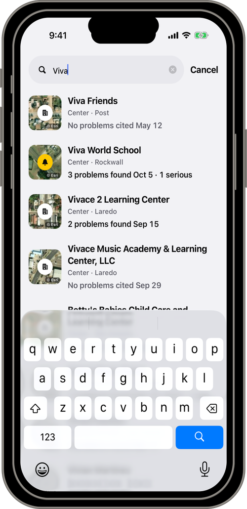
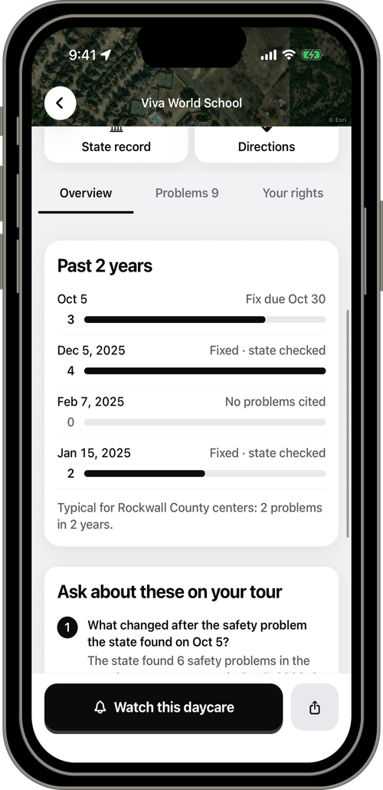
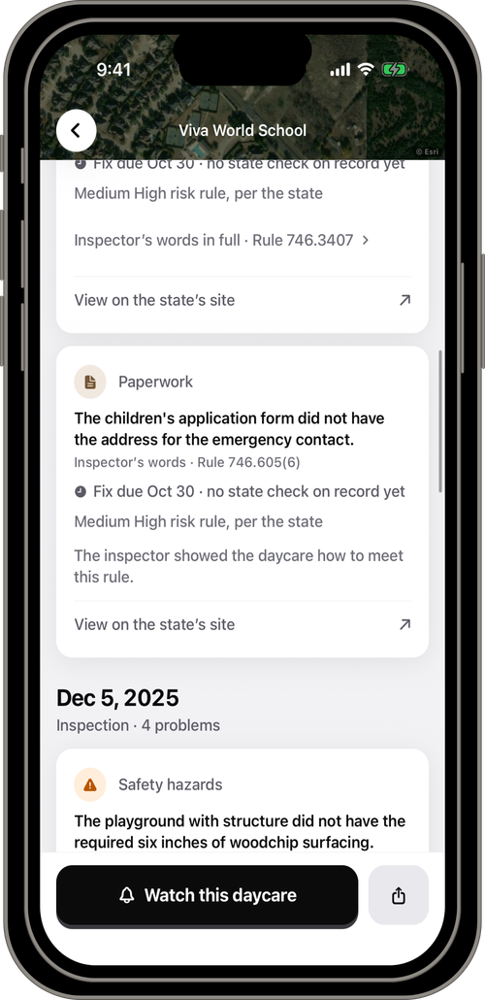
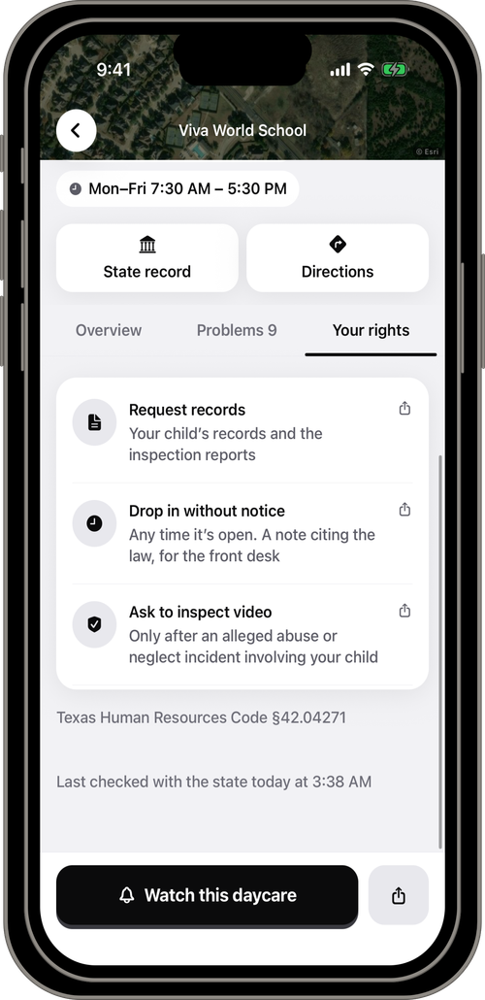
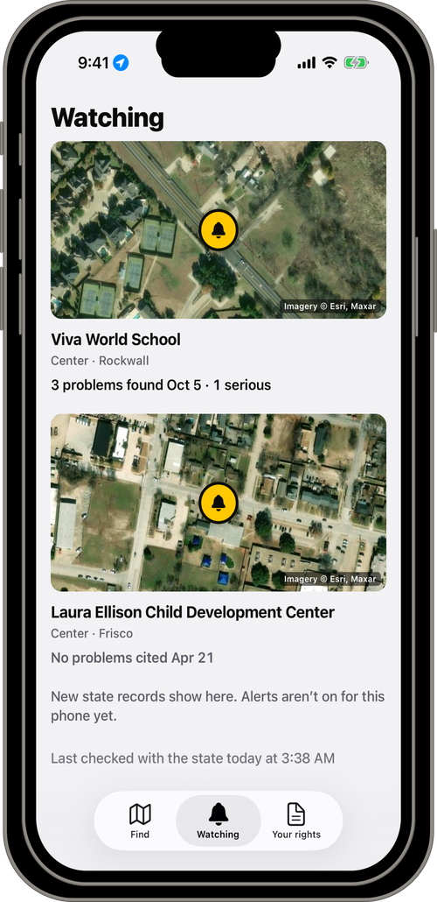
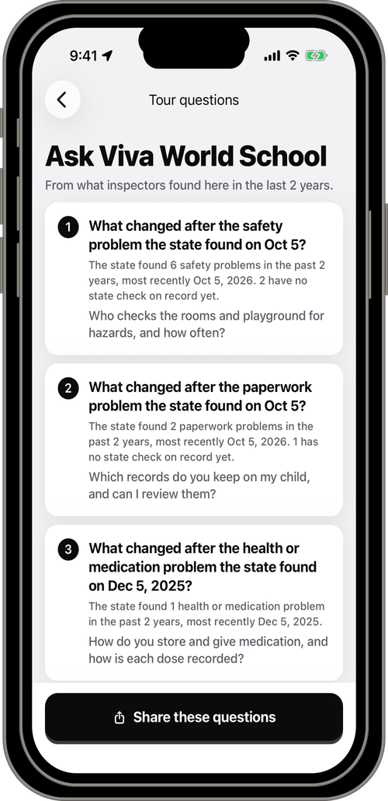
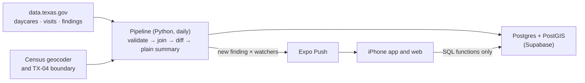

# Daycare Watch

**Find the right daycare for your family.**

See what Texas inspectors found at any daycare, and get a heads-up when they post something new.

### [Try it: daycare-watch.vercel.app](https://daycare-watch.vercel.app)
No sign-in. Real Texas state records. The website is a simple preview; the full app, with alerts, runs on iPhone and Android.

<picture>
  <source media="(prefers-color-scheme: dark)" srcset="docs/screenshots/hero-dark.png">
  
</picture>

Built for the **2026 Congressional App Challenge, Texas's 4th District**

## Why we built this

This app is personal to us. Areeb's cousin came home from her daycare crying every single day, and his uncle had no idea where to look. Texas already sends inspectors into every licensed daycare and publishes what they find, but it sits in an open dataset of more than a hundred thousand rows of rule numbers and legal language. In Texas's 4th District alone, inspectors wrote down 1,347 findings in the last two years. Daycare Watch puts those reports in front of parents in words they can follow, and tells them when something new is posted. We know the app cannot detect or prevent anything that happens at a daycare; it makes what the state already knows easy to find.

The app never calls a daycare safe or unsafe, and never scores, grades, or ranks one. It shows what the state found, when, and whether the state has checked the fix.

## Try it in 30 seconds

1. Open **[daycare-watch.vercel.app](https://daycare-watch.vercel.app)** on any phone or computer.
2. Search a name, city, or ZIP in TX-04, for example `Montessori`, `Rockwall`, or `75034`.
3. Open a daycare: what the state found at its latest visit, each finding with the inspector's own words, and a link to the official state record.
4. Scroll a little to the tabs under the daycare's name and tap **Your rights**: the three requests Texas law already gives parents (your child's records, a drop-in visit, incident video), written and ready to send.

In the phone app, **Watch this daycare** turns on a push alert for the next time the state posts something about it.

| Find | A daycare's record | Every finding |
|:-:|:-:|:-:|
| <picture><source media="(prefers-color-scheme: dark)" srcset="docs/screenshots/framed/dark/02-search.png"></picture> | <picture><source media="(prefers-color-scheme: dark)" srcset="docs/screenshots/framed/dark/03b-place-history.png"></picture> | <picture><source media="(prefers-color-scheme: dark)" srcset="docs/screenshots/framed/dark/04-findings.png"></picture> |
| **Your rights** | **Watch** | **Tour questions** |
| <picture><source media="(prefers-color-scheme: dark)" srcset="docs/screenshots/framed/dark/05-rights.png"></picture> | <picture><source media="(prefers-color-scheme: dark)" srcset="docs/screenshots/framed/dark/06-watch.png"></picture> | <picture><source media="(prefers-color-scheme: dark)" srcset="docs/screenshots/framed/dark/08-tour.png"></picture> |

## How it works

The state publishes three open datasets on data.texas.gov: daycares, visits, and findings. Each morning a GitHub Action downloads all three, checks every row against a typed data contract, joins each finding to the visit it came from (the run fails below 95%; it has been 100% on every run), and compares them with the day before. Anything new at a daycare a parent watches becomes one push alert per visit. The app reads the database only through a small set of SQL functions.

The one-line summary only shortens the inspector's first sentence; a test over all 133,739 findings in the state's file checks that it never adds a word or a number. Each stage, its guarantee, and its test are in [`docs/METHODS.md`](docs/METHODS.md).

## Built with

| Layer | Technology | What it does |
|---|---|---|
| App | Expo SDK 58, React Native 0.88, TypeScript, Expo Router | One codebase for iPhone, Android, and the web |
| Web | Static export hosted on Vercel | [daycare-watch.vercel.app](https://daycare-watch.vercel.app), the app inside a phone frame on desktop |
| Database | Supabase Postgres + PostGIS, row-level security | Nearest-daycare search, the TX-04 boundary, home-daycare privacy; the app reads it only through SQL functions |
| Pipeline | Python 3.12, Pydantic, GitHub Actions (every morning) | Download, validate, join, diff, and notify |
| Alerts | Expo Push | One alert per new visit for each parent watching that daycare |
| Tests | pytest + hypothesis, pgTAP, Jest, Maestro | 283 pipeline, 199 database, 63 app, plus end-to-end |

### Repository layout

| Path | What's in it |
|---|---|
| [`apps/mobile`](apps/mobile) | The Expo app: screens in `src/app`, shared UI in `src/components` |
| [`services/pipeline`](services/pipeline) | The Python pipeline (`src`), its SQL, and its tests |
| [`supabase`](supabase) | Database migrations, SQL functions, and the pgTAP tests in `supabase/tests` |
| [`packages/db`](packages/db) | Typed database client shared with the app |
| [`.github/workflows`](.github/workflows) | `daily-sync.yml` (the morning run) and `pipeline-ci.yml` (pipeline tests on every pipeline change) |
| [`docs`](docs) | Methods, data dictionary, testing, privacy, and sources |

## What the data shows

Drawn by [`scripts/figures.py`](scripts/figures.py) from the state's own files, pulled Oct 25 2026. All six figures, with n, source, and the exact SQL: [`docs/FIGURES.md`](docs/FIGURES.md).

**Where the 379 are.** At least 379 active daycares sit inside TX-04 by map point: 234 licensed centers (one dot each) and 145 home daycares, shown only as counts per area, never as points.

<picture>
  <source media="(prefers-color-scheme: dark)" srcset="docs/figures/tx04-map-dark.svg">
  
</picture>

**Did the state check the fix?** Of 49,768 findings in the last 24 months, the state recorded checking the fix on 89.1%, 10.0% were fixed during the visit, and 0.8% have neither on record yet. That is why the app says "Fixed" only with one of those two.

<picture>
  <source media="(prefers-color-scheme: dark)" srcset="docs/figures/fix-follow-through-dark.svg">
  
</picture>

**The nap rule.** A Texas center must not force a child to sleep (26 TAC §746.2905(1)). The state cited it 123 times from 2022 to Q3 2026, 8 of them inside TX-04.

<picture>
  <source media="(prefers-color-scheme: dark)" srcset="docs/figures/nap-rule-dark.svg">
  
</picture>

## Tests

Run on Oct 25 2026. Details and commands: [`docs/TESTING.md`](docs/TESTING.md).

| Suite | Result |
|---|---|
| Pipeline (pytest and hypothesis) | 283 pass, 93% line coverage, ruff and `mypy --strict` clean |
| Database (pgTAP): schema, row-level security, every SQL function, home privacy | 199 pass in 12 files |
| Live API against the cloud database | 94 of 94 endpoint checks pass |
| App unit (Jest) | 63 pass |
| End to end | Tapping a push with the app closed or in the background opens that visit's findings (Release build, Maestro); a replayed real finding arrived as a push on a real iPhone |

## Privacy

- Parents sign in anonymously: no name, email, or phone number.
- Home daycares show only the city and 5-digit ZIP: no street, no map of the house, no photos.
- A street picture of a center appears only after a person checked that it shows that daycare.
- A daycare is labelled "in TX-04" only when its map point is inside the district, never from the state's county field.

What is stored and what leaves the phone: [`docs/PRIVACY.md`](docs/PRIVACY.md).

## Sources and docs

Every legal, dataset, and district claim was checked against a primary source on Oct 25 2026. The 56 sources, each with the URL opened, and the full list of libraries, data, and services the project uses are in [`docs/SOURCES.md`](docs/SOURCES.md).

| Doc | What |
|---|---|
| [`METHODS.md`](docs/METHODS.md) | How every number is made, the pipeline in detail, and its limits |
| [`FIGURES.md`](docs/FIGURES.md) | Six data figures, each with n, source, and SQL |
| [`CONTEXT.md`](docs/CONTEXT.md) | North Texas: population growth, working parents, and child care deserts, from Census files |
| [`DATA.md`](docs/DATA.md) · [`ARCHITECTURE.md`](docs/ARCHITECTURE.md) | Every field shown and its state column · system design |
| [`DEVELOPMENT.md`](docs/DEVELOPMENT.md) | Run it yourself, project structure, roadmap |
| [`OFFICIAL_SOURCES.md`](docs/OFFICIAL_SOURCES.md) | Verbatim quotes behind every phone number and legal line in the app |

## Team

Areeb, Aydin, Praneel, and Parth, from Texas's 4th Congressional District.

## License

[MIT](LICENSE). State records are public data from the Texas Health and Human Services Commission on data.texas.gov.
