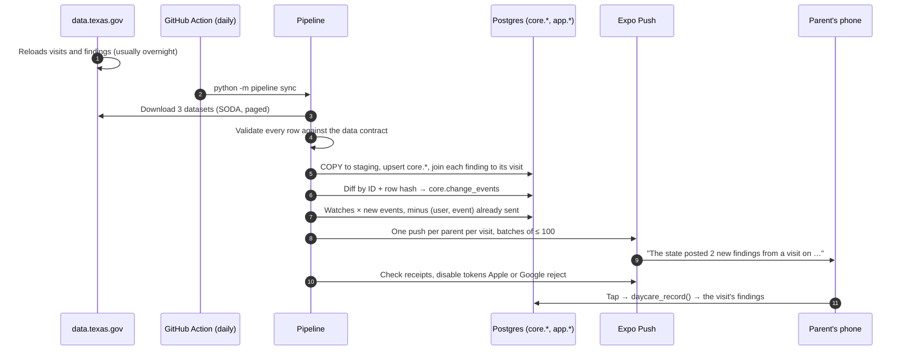
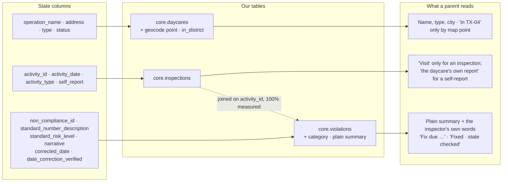

# Methods

How Daycare Watch turns the state's three files into what a parent reads, how every number in the README is made, and where each one can be wrong. Field-by-field mapping is in [`DATA.md`](DATA.md); the system design is in [`ARCHITECTURE.md`](ARCHITECTURE.md).

## Contents

- [Stack](#stack) · [The daily pipeline](#the-daily-pipeline) · [When the state posts something new](#when-the-state-posts-something-new) · [From the state's columns to the screen](#from-the-states-columns-to-the-screen)
- [The data](#the-data) · [Honesty and privacy rules](#honesty-and-privacy-rules) · [Methods and limitations](#methods-and-limitations)

## Stack

| Layer | Choice | Why |
|---|---|---|
| App | Expo (React Native), TypeScript strict, Expo Router, TanStack Query, react-native-maps, expo-notifications | One codebase for iPhone and Android (Android push needs a development or standalone build, not Expo Go) |
| Database | Supabase Postgres + PostGIS, row-level security, RPC functions, materialized views | The product is joins, geography (point-in-polygon, nearest daycares), and medians, all native in SQL |
| Pipeline | Python 3.12, httpx, pydantic v2, psycopg 3 (COPY), structlog | Daily full-table diffs of 200,000+ rows with a real test suite |
| Push | Expo Push API with receipts | One API for both platforms. Tokens Apple or Google reject are disabled |
| Types | `supabase gen types typescript` → `packages/db/types.ts` | The app's types come from the real schema, so they cannot drift |

## The daily pipeline

| Stage | Guarantee | Tested by |
|---|---|---|
| Validate | Unknown risk levels, bad dates, or missing fields fail the run | Contract tests on real captured records |
| Transform | Findings must join their visit at ≥ 95% or the run fails (measured: 100%) | `test_load.py` |
| Diff | Re-running a sync creates 0 new events | Idempotency test |
| Classify | Every finding gets a category from fixed rules on the state's rule number. The plain summary only shortens the inspector's words | `test_classify.py`, 100% coverage, checked against all 133,739 findings in the state file |
| Notify | One push per parent per event. A replay of a real past finding is labelled "Replay of a real state record from <date>" | `test_notify.py` round trip with receipts |
| Photos (hand-checked) | Only Licensed Centers with an exact address match. A photo ships only after a person looked at it and saw that daycare (its name on the building); at most 2 per center, from different drives, within 6 years | `test_photos.py` on recorded real API answers and the reviewed list `data/verified_photos.csv` |

## When the state posts something new

## From the state's columns to the screen

## The data

| Dataset | ID | What we observed (Oct 2026) | How we sync it |
|---|---|---|---|
| Operations (daycares) | `bc5r-88dy` | Row-level, about 300 to 450 rows a day statewide | Incremental by `:updated_at`, plus a weekly full reconcile |
| Activities (visits) | `m5q4-3y3d` | Full reload, usually overnight; about 205,000 rows | Full download, diff by `activity_id` + row hash |
| Violations (findings) | `tqgd-mf4x` | Full reload, usually overnight; about 134,000 rows | Full download, diff by `non_compliance_id` + row hash |

**Measured Oct 24 to 25 2026:**

| Fact | Number |
|---|---|
| In-scope daycares statewide (licensed centers, licensed and registered child-care homes, listed family homes) | 14,310 |
| State visits · findings loaded | 157,358 · 118,294 |
| Daycares with a map point | 13,024 (577 from state coordinates, 12,447 from the Census Geocoder) |
| Census match quality | 10,991 exact · 1,456 non-exact (the Census Geocoder's "Non_Exact" match type) |
| Active daycares inside TX-04 by map point | at least 379 (330 exact, 28 non-exact, 21 state coordinates). 23 more fall back to county only and are never labelled TX-04 |
| TX-04 centers with a street-level picture | Apple Look Around (iPhone app) gives a street-level picture for 6 of 20 TX-04 centers sampled, each checked by eye: 3 where Apple's place has the daycare's name within 60 m of the state's address, and 3 where a person checked that the street view at the address shows the building (`services/pipeline/data/street_view_checks.csv`). The other 14 show the view from above. Mapillary: a hand-checked photo for 1 of 209 Licensed Centers with an exact address match. 80 had any Mapillary image within 60 m of the building; all 107 images facing a building were checked by eye, and 2 (one center) showed the daycare |
| RPC latency, p95 on the full dataset | nearest daycares 7.5 ms · search 30 ms · daycare record 1 ms |

**Inside TX-04 only** (the 379 active daycares placed in the district by map point; 13 complete weeks, Jul 20 to Oct 18 2026):

| Fact | Number |
|---|---|
| State activities at these daycares | 284 at 158 daycares, about 22 a week (238 inspections, 42 reports, 4 assessments) |
| Activities that found violations | 65. Another 23 are still marked "Pending" (findings not posted yet) |
| Findings posted | 135: 31 under rules the state rates High risk, 55 Medium High, 47 Medium, 2 lower |
| Most common categories | Paperwork 46 · Safety hazards 34 · Health and medication 30 · Supervision 10 |
| Time between state inspections at one daycare | Median 66 days, 90th percentile 330 days (inspections since Oct 2023) |
| Daycares with at least one finding under a High-risk rule in the last 24 months | 140 of 379 |

## Honesty and privacy rules

These rules are enforced in code and tests, not just in copy review.

| Rule | Why |
|---|---|
| No scores, grades, rankings, or safe/unsafe labels. Color marks the state's risk level of one finding, never a daycare | A count of findings is not a verdict, and the state does not publish one |
| "Fixed" appears only as "Fixed during the visit" or "Fixed · state checked", never on its own. The state's `corrected_date` is shown as "Fix due <date>" | 124 findings carry a `corrected_date` in the future, so it behaves like a deadline |
| A daycare is labelled "in TX-04" only when its map point is inside the district | The state's county field can be wrong, and most of Collin and Denton counties are outside TX-04 |
| A street-level picture is shown only where a person checked it shows that daycare: Apple Look Around for 6 of 20 TX-04 centers sampled, Mapillary for 1 of 209 | Rules alone picked the wrong building 3 times in 5, because a Census address point sits on the street, not the building. Most street imagery here is dashcam footage of the road. A wrong photo on a daycare's page would be worse than none |
| Home daycares (4,705 statewide) get no imagery, no map of the house, and no street address: city and 5-digit ZIP only | They are the caregiver's own home |
| Map links send the state's address line, not our estimated point | The geocode is an estimate |
| Kids' Law request cards are hidden for listed family homes | HRC §42.04271(a) does not cover them |
| The app never claims to alert when an investigation opens, or to be the only way to get updates | Findings appear only after state due process, and the state already offers email updates per daycare |
| No made-up data anywhere, including tests | Every fixture is a real captured record |

Parents sign in anonymously: no name, email, or phone. What is stored and what leaves the phone: [`docs/PRIVACY.md`](PRIVACY.md). Every phone number, URL, and legal line traces to a verbatim quote in [`docs/OFFICIAL_SOURCES.md`](OFFICIAL_SOURCES.md).

## Methods and limitations

How each number on this page is made, and where it can be wrong.

| Topic | Method | Limitation |
|---|---|---|
| **Scope** | Four operation types the state licenses or lists: licensed centers, licensed child-care homes, registered child-care homes, listed family homes (14,310 of 14,977 rows in the operations file). Findings and visits are kept when they belong to one of these | Other operation types (for example residential care) are out of scope |
| **Joining findings to visits** | Each finding joins its visit on `activity_id`. A run fails below 95% | Measured 100% on every run so far |
| **Validation** | Every row passes a typed data contract (pydantic). An unknown risk level, a bad date, or a missing field fails the whole run instead of loading a guess | A new value the state introduces stops the sync until the contract is updated |
| **State text** | Shown as the state wrote it, with two repairs: a `?` the state's file put where a character was lost is restored in 69 of 70 daycare names, and lost apostrophes ("child?s") in findings | The plain summary shortens and de-jargons; a property test checks it never adds a number |
| **Placing daycares** | State coordinates when present (577), else the U.S. Census batch geocoder (12,447: 10,991 exact, 1,456 non-exact). "In TX-04" means the point is inside the Census TIGERweb CD119 boundary, Jan 1 2026 vintage (PostGIS `ST_Covers`) | A Census point sits along the street's address range, not on the roof. 1,286 daycares have no point; 23 near TX-04 fall back to county only and are never labelled TX-04 |
| **Freshness** | The pipeline runs daily from GitHub Actions at 10:15 and 11:47 UTC; every data screen shows "Last checked with the state" | The state reloads usually overnight, not every night (no reload seen Sat night, Oct 24 to 25). GitHub started the Oct 25 runs 3 to 4 hours late |
| **Time from visit to posting** | Measured per run: days from `activity_date` to the night a finding first appears (median and 90th percentile in `ops.sync_runs`) | **Not yet measured.** The history was loaded in one backfill, and the state has posted nothing new since. The state posts violations only after the daycare has had due process or waived it [[17]](SOURCES.md#references); the state gives no time frame, and we have not measured one yet |
| **Alerts** | One push per parent per visit with new findings, deduplicated on (parent, event); permit status, capacity, and enforcement flags too | Never on an investigation opening: the state publishes findings only after due process |
| **Pictures** | Shown only after a person checked they show that daycare (Apple Look Around 6 of 20 sampled; Mapillary 1 of 209) | Most daycares show only the view from above |
| **Homes** | City and 5-digit ZIP only: no street, no map of the house, no imagery | |

**What the app never claims:** that a daycare is safe or unsafe; any score, grade, or rank; that a fix happened unless the state recorded checking it; that an alert arrives when an investigation opens; that it is the only way to follow a daycare (the state offers email updates).
